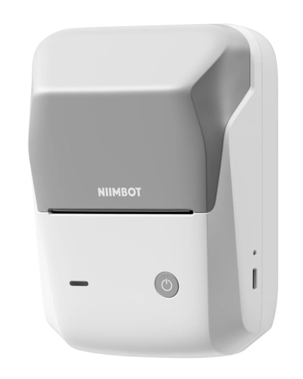
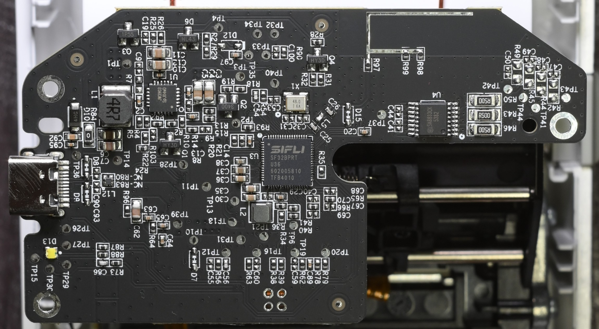
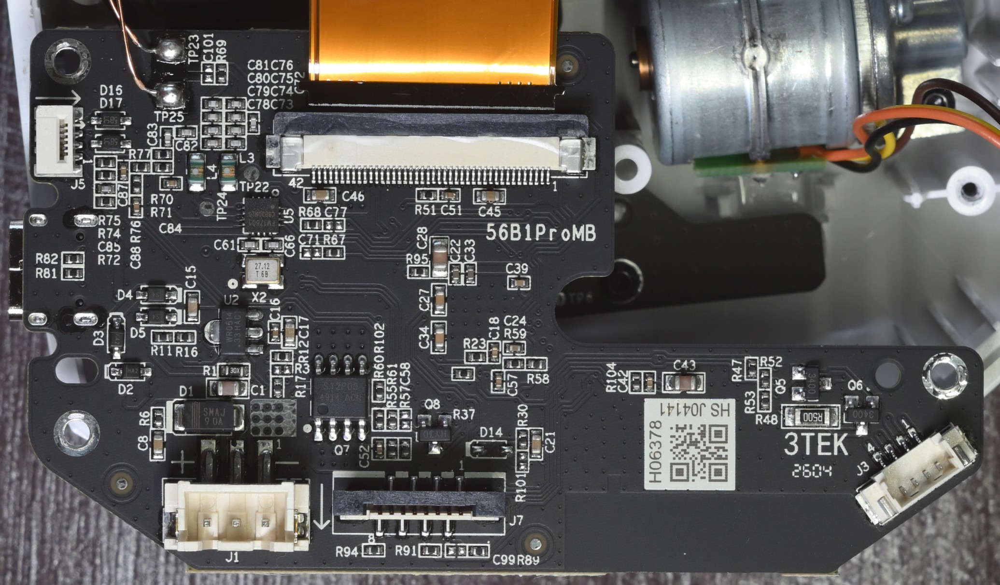
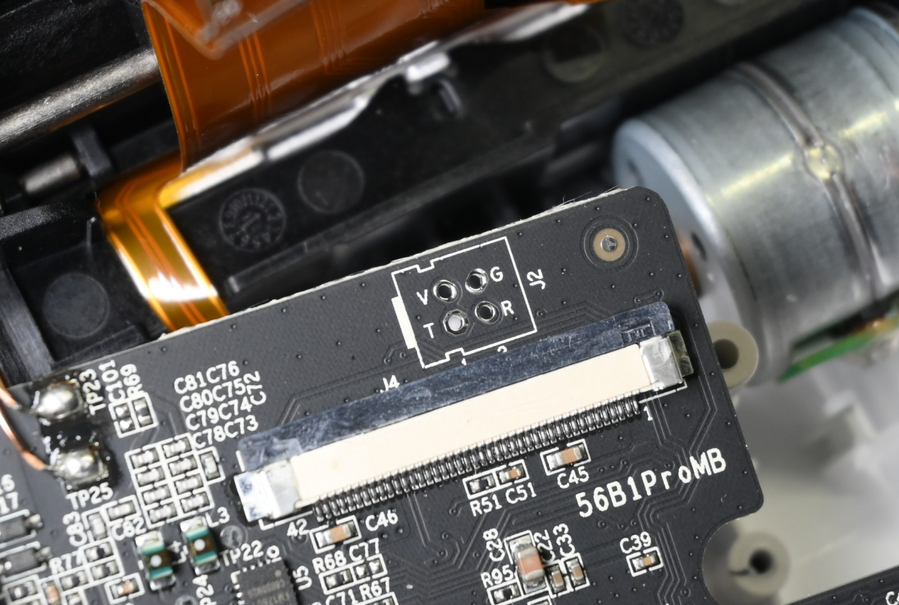

# NIIMBOT B1 Pro

# Properties

<!-- BEGIN B1_PRO CLOUD_INFO -->
<!-- Auto-generated, do not edit -->
| Parameter                                 | Value                   |
| ----------------------------------------- | ----------------------- |
| ID                                        | 4097                    |
| DPI                                       | **300**                 |
| Printhead size                            | 48mm / 576px (verified) |
| Print direction                           | top                     |
| [Paper types](../../other/label-types.md) | 1,2,5                   |
| Density range                             | 1-[3]-5                 |
| Printer type                              | thermal                 |
<!-- END CLOUD_INFO -->

## HW

| Parameter                              | Value                                                   |
| -------------------------------------- | ------------------------------------------------------- |
| MCU                                    | SiFli SF32BPRTU36 (it seems to be SF32LB52x compatible) |
| Firmware file offset                   | 0x1C                                                    |
| SiFli bootloader                       | 0x0 - 0xFFFF                                            |
| Bootloader                             | 0x10000000 - 0x10008FFF                                 |
| Application (update process writes it) | 0x10009000 – 0x10088FFF                                 |
| Factory data (serial number and other) | 0x100FE000 – 0x100FE107                                 |
| Settings                               | 0x100FF000 – 0x100FF253                                 |

B1 PRO uses [compressed firmware file payload](../../firmware/index.md#structure-of-compressed-firmware-file).

