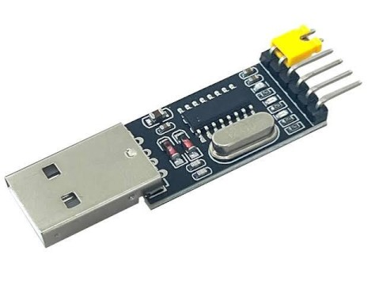
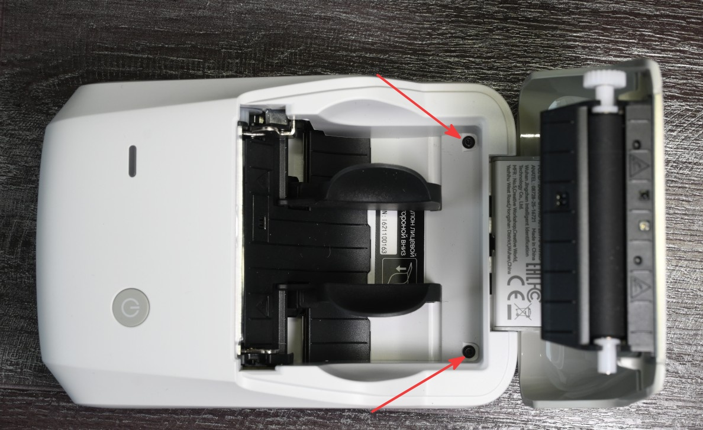
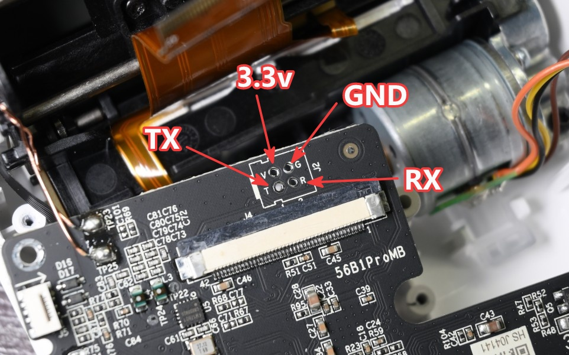
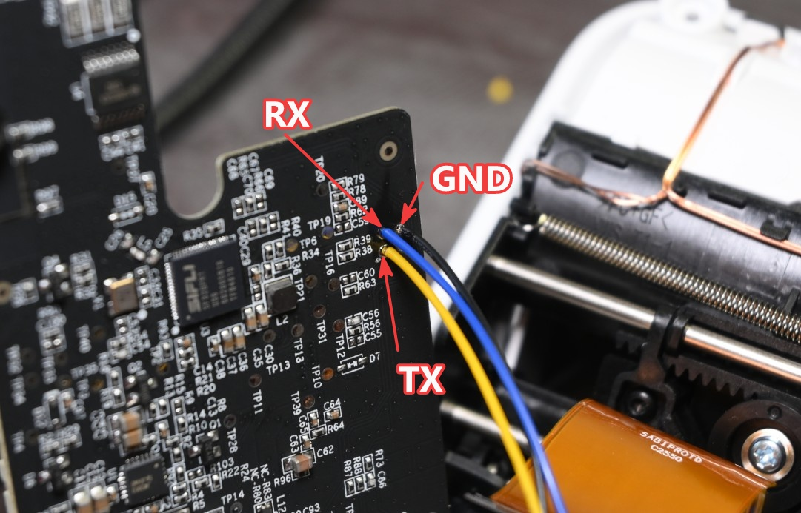
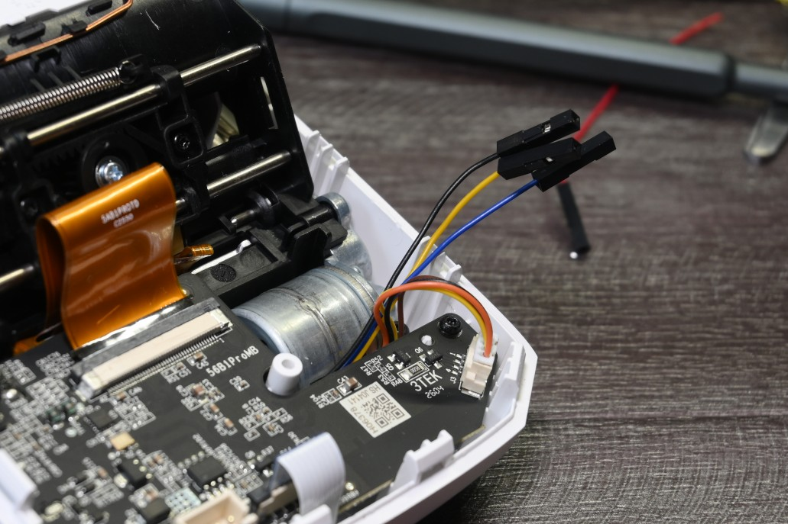
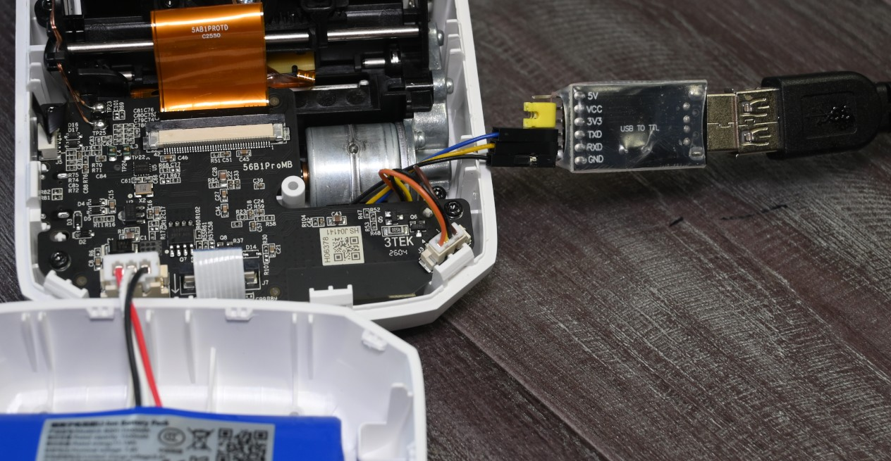
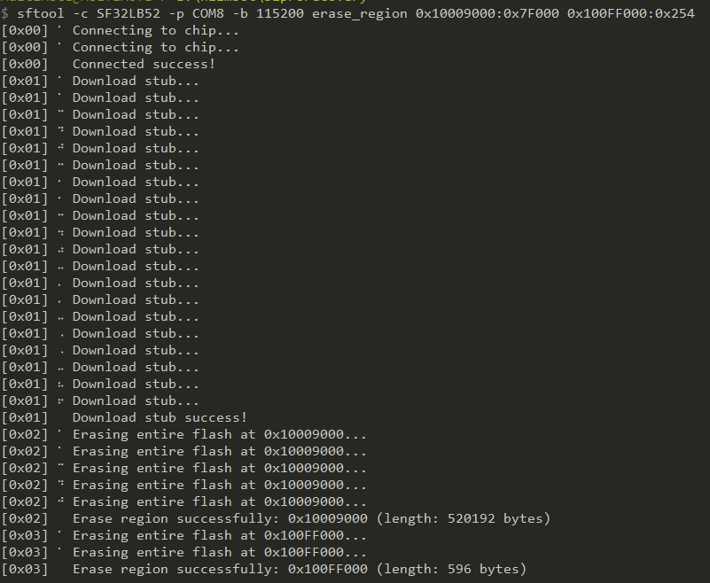
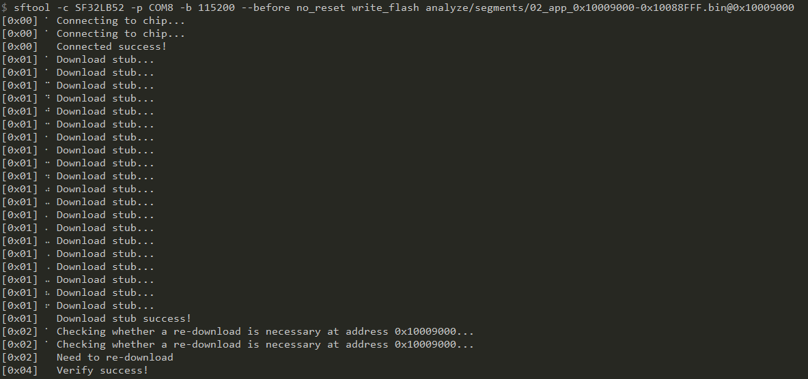

# Unbricking NIIMBOT B1 Pro

!!! warning

    This guide applies to the B1 Pro `2.01` hardware version. For other versions, steps and files may differ.

You will only need a USB to UART adapter and [sftool](https://github.com/OpenSiFli/sftool/releases).



In this guide I will use a CH340 USB to UART adapter, but any adapter with 3.3V logic levels should work. Do not use 5V logic level adapters, as they may damage the printer.

CP2102 based adapters are known to work, but it will need to be tweaked to support `1000000` baud rate with special tool (`CP21xx customization utility`).

All the actions will be performed on a Windows machine, but Linux and MacOS should work as well.

## Memory map

Here is a memory map of the B1 Pro firmware, with the corresponding files dumped from a working printer.

| Block name                             | Location                | Size (dec (hex)) | File                                                                                                                               |
| -------------------------------------- | ----------------------- | ---------------: | ---------------------------------------------------------------------------------------------------------------------------------- |
| Bootloader                             | 0x10000000 - 0x10008FFF |   36864 (0x9000) | [bootloader_bl2_0x10000000-0x10008FFF.bin](../files/b1_pro/unbrick/fw_segments/bootloader_bl2_0x10000000-0x10008FFF.bin)           |
| Application (update process writes it) | 0x10009000 - 0x10088FFF | 520192 (0x7F000) | [app_0x10009000-0x10088FFF.bin](../files/b1_pro/unbrick/fw_segments/app_0x10009000-0x10088FFF.bin) (version 2.18)                  |
| Factory data (serial number and other) | 0x100FE000 - 0x100FE107 |      264 (0x108) | [factory_data_sector_0x100FE000-0x100FEFFF.bin](../files/b1_pro/unbrick/fw_segments/factory_data_sector_0x100FE000-0x100FEFFF.bin) |
| Settings                               | 0x100FF000 - 0x100FF253 |      596 (0x254) | [settings_sector_0x100FF000-0x100FFFFF.bin](../files/b1_pro/unbrick/fw_segments/settings_sector_0x100FF000-0x100FFFFF.bin)         |

Full dump: [MPI1_0x10000000_0x100000.bin](../files/b1_pro/unbrick/fw_segments/MPI1_0x10000000_0x100000.bin) (flash address `0x10000000`).

## Unbrick procedure

1. Disassemble the printer. You need to unscrew two Torx screws under the lid.

    The two halves of the case are held together by latches, and they’re quite secure.

    It takes some effort to take them apart. You can separate the two halves using a plastic card.

    

2. Disconnect all connectors from the mainboard.

3. Unscrew the mainboard from the case and carefully turn it over.

    Be careful with RFID antenna wires and the printhead ribbon cable.

    You can also heat the glue on the ribbon cable connector and detach the ribbon cable from the connector. This will make it easier to access the UART pads.

4. Solder wires to the UART pads from bottom side of the mainboard.

    

    

5. Connect printhead ribbon cable if you detached it in step 3.

    Return the board to its original position and reconnect the connectors—except for the battery.

    If you plan to leave your soldered wires in the printer, you can screw the circuit board in place.

    

6. Connect `RX`, `TX` and `GND` wires to the USB-UART adapter. Make sure you connect the wires correctly: `TX to RX`, `RX to TX`, `GND to GND`.

    Connect the battery.

    Connect the adapter to your computer.

    


7. Position the printer so that you can press the power button.

8. First we need to erase application and settings region. We clear the app region just because, but we need to clear the settings region to reset the OTA flag.

    Open command prompt and enter following command. Not send it yet:


    ```
    sftool -c SF32LB52 -p COM8 -b 115200 erase_region 0x10009000:0x7F000 0x100FF000:0x254
    ```

    Replace `COM8` with the correct COM port for your USB to UART adapter.
    At the default baud rate (`100000`) I sometimes got errors, so I set it to `115200` and it worked fine.


    Hold the power button and press `Enter` to send the command. Do not release the power button until process is finished.

    

9. Now we can flash the application region. Enter following command, but do not send it yet:

    ```
    sftool -c SF32LB52 -p COM8 -b 115200 write_flash 02_app_0x10009000-0x10088FFF.bin@0x10009000
    ```

    Replace path to the file (`02_app_0x10009000-0x10088FFF.bin`) with the correct path to the application file (link to the file is in [memory map](#memory-map) section).
    Do not remove the `@0x10009000` part, it is important. It is not a part of path, it tells the tool where to flash the file in the printer memory.

    Hold the power button and press `Enter` to send the command. Do not release the power button until process is finished.

    

10. Printer should play a power on sound and the LED should turn on. Congratulations, you have successfully unbricked your printer.

    If your device memory is corrupted in other regions, you can also flash the factory data and settings regions using the same command as in step 9,
    but with different files and addresses. Be careful, flashing the factory data region will overwrite your printer serial number and other unique parameters.


<hr>

Many thanks to user mode01, that first discovered the flashing procedure and shared it.

Useful links:

* [sftool-0.2.5-i686-pc-windows-msvc.zip](../files/b1_pro/unbrick/sftool-0.2.5-i686-pc-windows-msvc.zip)

* [SF32LB52x-Datasheet](<../files/b1_pro/unbrick/DS5201-SF32LB52x-Datasheet V2p5.pdf>)

* Another restore info from gcrts: https://github.com/gcrts/b1pro-unbrick
